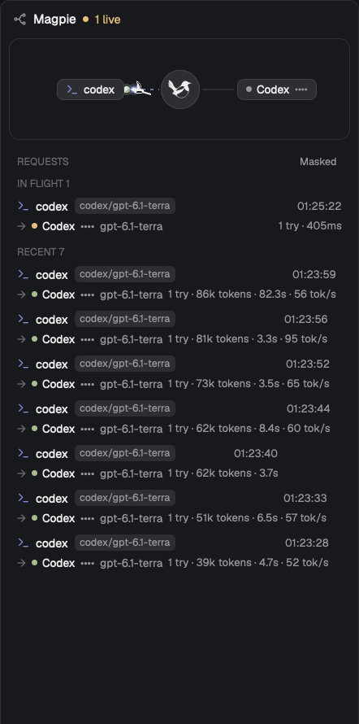

# herdr-magpie-routing

A Herdr layout with a live view of [magpie](https://github.com/yetone/magpie)'s routing, opened from a Routing button next to Files and Changes.



## Install

Needs Herdr (built against 0.1.13) and magpie running on the same machine, with its gateway at `127.0.0.1:3425`.

```sh
gh repo clone isnine/herdr-magpie-routing
cd herdr-magpie-routing
mkdir -p ~/.config/herdr-app/mods
cp -R mods/routing mods/tabs-routing ~/.config/herdr-app/mods/
cp layouts/main-routing.json ~/.config/herdr-app/layouts/
herdr-app check ~/.config/herdr-app/mods/routing
herdr-app do layout.switch --name main-routing
```

Copy `mod.json` along with `main.js` (as above): a mod first seen without it gets docked as an extra panel.

`ctrl-shift-l` switches back to your previous layout. See [RECIPE.md](RECIPE.md) for how it is built.

## License

The magpie bird, flight paths and animation timings come from magpie, under the MIT license in [LICENSE.magpie](LICENSE.magpie).
