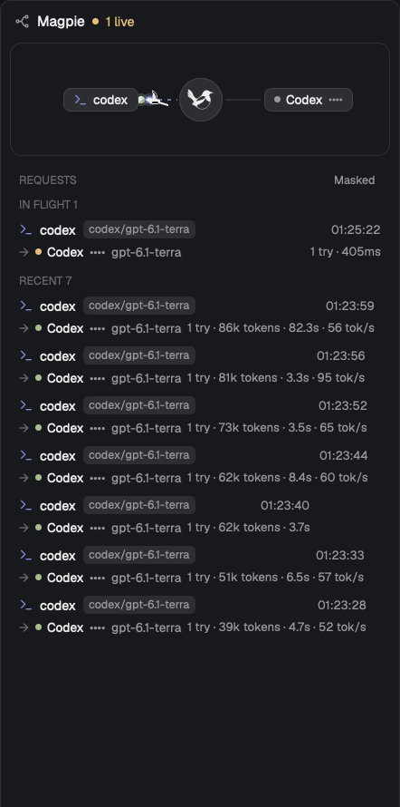

# Magpie Routing

Herdr's main layout with one more side panel: a live picture of what magpie's gateway is doing with each request. Magpies carry requests from agents through magpie to providers and bring the answers home.

## What you see

- Tab bar: a Routing button right of Files and Changes, same size and selected look.
- Routing panel, bottom right: Codex, Claude and Antigravity icons, each with a ring filled by its fullest 5-hour or 7-day window and labelled `5h` or `7d` (green below 60%, yellow below 90%, then red). Clicking opens the Usage panel.
- Panel, in Herdr's 368px side column, top to bottom:
  - Header, 22px: route icon, "Magpie", pulsing dot and "N live" while requests are in flight.
  - Stage, 104px, radius 11: up to 3 agents on the left, a 40px hub with the magpie mark in the centre, up to 3 providers on the right. Nodes are 22px pills with 6px gaps. Wires are cubic curves, 1.5px, theme `border`.
  - Request list: Masked/Shown toggle, IN FLIGHT rows (up to 6), followed by recent rows. Rows are 46px: agent, requested model tag, time; then provider, masked account, model, tries, tokens, duration, tok/s.
  - Footer: gateway address, pid, serves, calls, retried.

## How it behaves

- A request: a bird carries a dot (agent colour) to the hub in 420ms and to the provider in 460ms, quad ease in-out, banked up to 24 degrees along the wire.
- The bird lets go at the provider and flies off up-right over 450ms; the dot pulses there (1200ms) while the wire flows in dashes (3 on, 5 off, 700ms cycle).
- Success: a new bird brings a green dot home, 420ms per wire.
- Failure: the dot turns red, waits 260ms, returns to the hub in 360ms, and the next try flies on; with no try left it goes home red.
- Wings beat every 420ms from the shoulder, far wing 30ms ahead.
- At most 4 requests fly at once; others are only listed.
- Masked (default) shows accounts as `••••`. The choice is kept per copy.
- Clicking Routing toggles the panel. The side panel choice is remembered per space.

## Built from

- `layouts/main-routing.json`: a clone of `main`; `tabs` block uses `tabs-routing`; `panel-body` stack gains block `routing`.
- `mods/routing` also polls `/v1/magpie/quotas?kept=1` every 30s while shown (a full read every 5 minutes) and publishes `shared("usage.quotas")`.
- `mods/usage`: the popup listing every account's windows.
- `mods/tabs-routing`: a clone of `tabs` with `panelButton("routing", ...)`, and `routing` added to the enabled panels.
- `mods/routing`: `fetch` long polls `GET /v1/magpie/trace?after=<seq>&wait=1`. Wires and birds use `window.paint_path` with `PathBuilder`; dots are rounded divs. The loop is `cx.timer.after`.
- Shipped mods used: `agents`, `changes`, `files`, `pane`, `spaces`, `workspace-chrome`, `workspace-status`.
- Reaches the network: `127.0.0.1:3425` only. Runs no programs.

## Watch out

- `on_size_change` reports zoomed pixels; divide by `settings().zoom` or the stage overflows.
- `dash_array` has no offset, so the flowing dashes are cut by hand.
- GPUI cannot animate along a path, so the stage redraws on a timer: 33ms with birds in the air, 88ms with only wires flowing, none when idle or hidden.
- Write `mod.json` before `main.js`, or Herdr docks a copy using default placement.
- The gateway address is the `GATEWAY` constant in `mods/routing/main.js`.
- The trace endpoint answers only local callers, so magpie must run on the machine showing the panel.
- `tabs-routing` and the layout are clones and don't follow Herdr updates.

## Done when

- `herdr-app check` passes for `routing`, `tabs-routing` and `usage`.
- `herdr-app do layout.switch --name main-routing` shows a Routing button right of Changes.
- With magpie running, a request appears under IN FLIGHT, a bird flies it across the stage, and the request moves to the recent list when answered.
- Hiding and showing the panel leaves `herdr-app status` with no errors.
